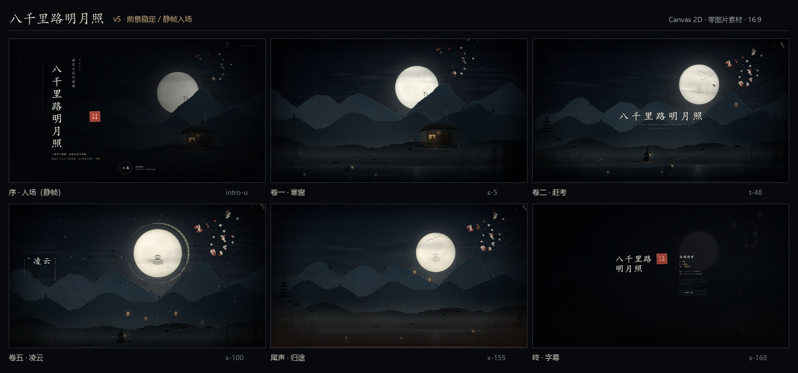

# 八千里路明月照

一个纯 Canvas 2D 实时绘制的水墨 MV：零图片素材、零第三方前端依赖，16:9，完整 2:53。

[在线预览（静音演示）](https://yenefa.github.io/bql-mv/) · [验收预览图](docs/preview.jpg)



## 特性

- 山水、云气、月宫、梅枝、仙鹤、旅人、湖面、小舟、天灯、芦苇全部由代码实时生成，没有一张图片素材。
- 7 个章节、两条主副题字、片尾字幕、进度条、全屏与音量控制。
- 音频包络驱动月晕、呼吸与节拍粒子；支持本地音源，也支持缺少音源时的静音演示。
- 纯前端、零依赖，`index.html` + 4 个静态文件即可运行。
- 针对长时间播放做了帧间稳定性处理：静态颗粒、循环粒子边界淡出、Canvas 同步合成、DPR 上限。

## 运行

需要 Python 3（仅用于本地静态服务器；页面本身不需要构建）。

Windows：

```text
双击 播放MV.bat
```

macOS / Linux：

```bash
bash serve.sh
```

然后打开 <http://127.0.0.1:8123>。

也可以使用任意静态服务器，例如：

```bash
python3 -m http.server 8123
```

直接双击 `index.html` 也能看到画面，但部分浏览器会限制本地音频，建议通过本地服务器打开。

## 音源与版权

**本仓库不包含歌曲录音文件。** 这是出于音乐版权考虑，而不是代码依赖。

- 缺少 `audio/song.mp3` 时，页面会自动进入**静音演示**，完整画面和镜头仍然播放，并显示提示。
- 如果你拥有该录音的公开使用或发行权，把音频保存为 `audio/song.mp3`，刷新页面即可带声播放。
- 请不要向本仓库提交未获授权的录音。
- `env-data.js` 中是为画面节拍预计算的响度包络，不是歌曲录音，也无法还原录音。

原曲信息：《八千里路明月照》，词 阿仁，曲 黄泯国，演唱 泽国同学。录音版权归原权利人所有。

## 操作

| 操作 | 按键 |
| --- | --- |
| 播放 / 暂停 | `Space` |
| 后退 / 前进 5 秒 | `←` / `→` |
| 全屏 | `F` |
| 静音 | `M` |

进度条可拖动；鼠标静止数秒后控制条自动隐藏。

## 目录

```text
index.html          页面、入场、章节与片尾 DOM
mv.js               Canvas 2D 场景、时间轴、相机、粒子与交互
style.css           页面与字幕样式
env-data.js         音频响度包络（非录音）
audio/              音源占位说明（录音不随仓库分发）
docs/               预览图
播放MV.bat          Windows 本地服务器启动器
serve.sh            macOS / Linux 本地服务器启动器
```

## 技术

- 1920 × 1080 虚拟画布，按视口缩放；DPR 上限 1.25 / 2400px，兼顾清晰度与帧率。
- 时间轴由 CUES 关键帧插值，章节、题字、镜头和粒子都由同一时间驱动。
- 音频使用 Web Audio AnalyserNode 与预计算包络；没有音频时回退到静音时钟。
- 所有山体、雾、云、纸纹、颗粒和光晕都在启动时烘焙，之后逐帧合成。
- 首次打开需要几秒做程序化纹理烘焙，属于预期行为。

## 制作

MV 代码与生成视觉：Yenefa。  
原曲：词 阿仁 / 曲 黄泯国 / 演唱 泽国同学。

## License

代码与仓库内由代码生成的预览图采用 MIT License，见 [LICENSE](LICENSE)。  
该许可不包含歌曲录音；录音不在本仓库中。

---

## English

A zero-asset, pure Canvas 2D Chinese ink music video. Everything is drawn procedurally at runtime; there are no image files and no front-end dependencies.

The soundtrack is **not** included for copyright reasons. The page automatically falls back to a silent demo when `audio/song.mp3` is missing. If you own the rights, add the file locally to play with sound.

Code and generated visuals are MIT licensed. The original song and recording remain the property of their respective owners.
